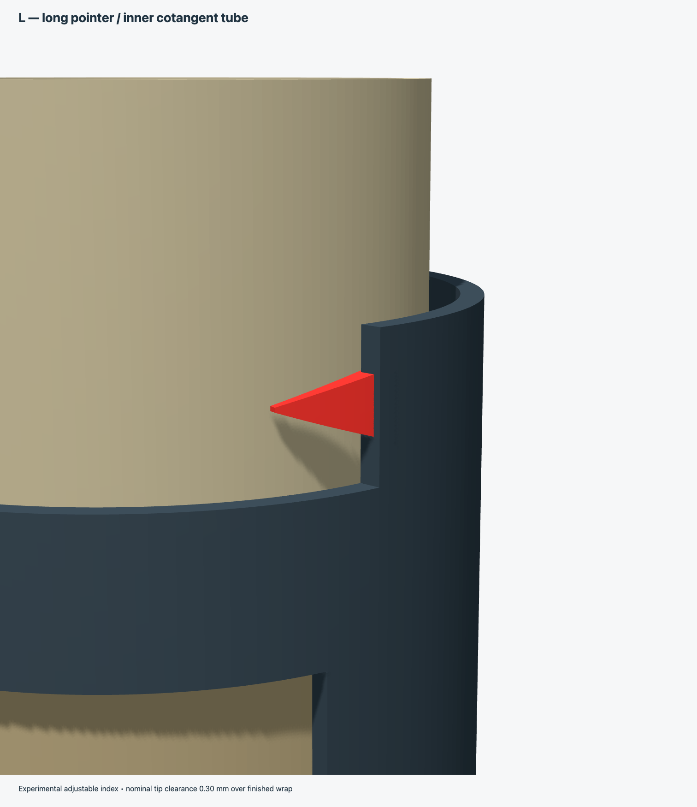
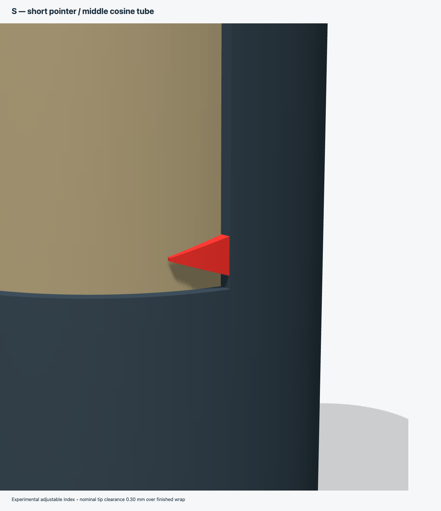

# Bygrave V1.1 - Pointer Prototype and Browser Simulator

A 3D-printable mechanical core for building a working **Bygrave Position Line Calculator** for celestial navigation.

The Bygrave is a cylindrical slide rule designed to solve the spherical triangle used in celestial sight reduction. This project provides printable concentric tubes and an outer cursor/frame intended to be used with the excellent reproduction scale artwork created by **Wayne Harrison**.


## Browser simulator

The interactive teaching simulator is separate from the printer files in [`simulator/`](simulator/). It includes 3D and flat displays, guided sight reduction, fine movement controls, definitions, A → Zn rules, and a compact Setup → Move → Read guide above the tube. It generates its own mathematical scales; Harrison's copyrighted artwork is not bundled.


[View the flat-scale screenshot](simulator/screenshots/flat-reduction.png).

### Install and run

You need **Python 3** and a modern web browser. Node.js and npm are not required to use the simulator.

1. Clone this repository, or use GitHub's **Code → Download ZIP** and extract it.

   ```sh
   git clone https://github.com/kq6up/bygrave.git
   cd bygrave
   ```

   If you downloaded a ZIP, open a terminal in its extracted repository folder instead.

2. Start the local server from the repository folder:

   ```sh
   python3 -m http.server 8000 --bind 127.0.0.1
   ```

   On Windows, use `py -3 -m http.server 8000 --bind 127.0.0.1` if `python3` is unavailable. Install Python 3 first if neither command is available.

3. Open [http://127.0.0.1:8000/simulator/](http://127.0.0.1:8000/simulator/) in your browser. Keep the terminal open; press **Ctrl+C** to stop the server.

Do not open `index.html` directly as a file; its JavaScript modules require a local HTTP server. If port 8000 is busy, use another port, such as 8001, in both the server command and browser URL.

See the [simulator README](simulator/README.md) for operation, angle conventions, supported sights, and known limits. Its 3D geometry is schematic and does not validate the printed instrument's fit or scale registration.

## Repository layout

- **Printer files:** OpenSCAD, STL, and assembly/exploded renders remain at the repository root; their instructions follow below.
- **Simulator:** browser source, bundled libraries, documentation, and developer checks are contained in `simulator/`.

## Experimental red-pointer prototype

The mechanical files now include integral triangular **L and S pointers**, inspired by the supplied concept illustrations. L reaches toward the inner cotangent tube; S reads the middle cosine tube. The pointers are shown red in CAD renders. A normal single-material STL prints them in the same material as the sleeve; paint them red for visibility.

**This is an experimental mechanical prototype. Its pointer positions are not registered to Harrison's artwork, and the teaching simulator does not establish that registration.** Print the cursor coupons and calibrate the finished wraps before committing to the long sleeve. See [CAD validation and limitations](docs/cad-validation.md).





### Pointer controls

| Parameter | Default | Meaning |
|---|---:|---|
| `pointers` | `true` | Include both tips in the outer sleeve STL |
| `pointer_l_from_top` | 6.35 mm | L tip 190.50 mm above sleeve bottom |
| `pointer_s_from_top` | 126.15 mm | S tip 70.70 mm above sleeve bottom |
| `pointer_l_gap`, `pointer_s_gap` | 0.30 mm | Nominal radial gap over finished scale tube |
| `pointer_arc` | 8.0 mm | Arc from window edge to reading tip |
| `pointer_tip_height` | 0.40 mm | Finite axial reading-edge width |
| `pointer_tip_thickness` | 0.80 mm | Radial thickness of reading tip |
| `middle_assembly_z` | -12.0 mm | Rendered middle-tube offset; no physical stop is provided |

`middle_assembly_z` places the middle rim below the inward-reaching L in the displayed pose. The middle must remain below the L body during use; axial motion beyond this envelope can cause a collision. The adjustable defaults follow the illustrations, not verified scale indices. Changing wraps or tip positions requires rechecking the clearances and registration.

Export the two small sleeve-edge coupons with:

```sh
openscad -o bygrave_cursor_coupons.stl -D 'part="cursor_coupon"' bygrave_3dprint.scad
```

They are sections of the actual sleeve and integral pointer geometry. L and S coupons retain their different radial reach. Check both on the cured, wrapped tubes; determine supports and print orientation in your slicer. A coupon fit is necessary but does not validate sight-reduction accuracy.

## Project status

This is an early prototype intended for practical experimentation, dimensional calibration, and eventual use with Harrison's scale artwork.

The current design includes:

- parametric OpenSCAD source
- inner scale tube
- middle scale tube
- outer cursor/frame tube with adjustable L and S pointers
- small cursor-edge test coupons
- printer check rings for the scale-bearing diameters
- fit-ladder rings for choosing bore clearances
- assembled and exploded reference renders

The mechanical design is deliberately simple so that diameters, clearances, and tube lengths can be adjusted after real-world test prints.

## Files

| File | Purpose |
|---|---|
| `bygrave_3dprint.scad` | Parametric OpenSCAD source |
| `bygrave_inner_tube.stl` | Inner/cotangent-scale tube |
| `bygrave_middle_tube.stl` | Intermediate/cosine-scale tube |
| `bygrave_outer_cursor_tube.stl` | Outer cursor/frame tube |
| `bygrave_cursor_coupons.stl` | Small sleeve-edge sections with integral L/S tips |
| `bygrave_calibration_rings.stl` | Compatibility alias of OD-check rings |
| `bygrave_pointer_detail.png` | Render of actual pointer CAD |
| `bygrave_od_check_rings.stl` | Short rings at the three scale-bearing diameters — print these first |
| `bygrave_ladder_middle.stl` | Five fit rings for the middle bore, stepped over the wrapped inner tube |
| `bygrave_ladder_outer.stl` | Five fit rings for the outer bore, stepped over the wrapped middle tube |
| `bygrave_assembly.png` | Assembled render |
| `bygrave_exploded.png` | Exploded render |


## Scale artwork

The scale artwork used as the dimensional basis for this project was created by **Wayne Harrison** as part of his Bygrave reproduction work.

His project page is here:

- [Wayne Harrison — Bygrave Position Line Calculator](https://sites.google.com/site/nwayneharrison/home-1/home/bygrave-position-line-calculator)

The three scale PDFs are currently hosted by Harrison on Google Drive:

- [BygraveOuterv1.PDF](https://drive.google.com/uc?id=1IrVQKK_weB279gs3gEThEIHK9tWyrfMt&export=download)
- [BygraveInnerv1.pdf](https://drive.google.com/uc?id=1CY2NsDVFTGT7_ikUx5sv4jWs2JfmGCPY&export=download)
- [ByGraveMiddleV1.pdf](https://drive.google.com/uc?id=1YdEeBbvnmQ9Cu7vAnQecdasszpAixOGi&export=download)

**These PDFs are not included in this repository.** Harrison's artwork is copyrighted, and permission to redistribute it is being requested. Until explicit permission is granted, this repository links to the original files rather than mirroring them.

## Dimensions: the artwork is fixed, the bores are measured

Harrison's scales only meet themselves at the seam when the wrap circumference is right, so the artwork sets the scale-bearing diameters and never gets scaled.

| Part | Artwork circumference | Artwork diameter |
|---|---:|---:|
| Inner scale | 169.6466 mm | 54.0002 mm |
| Middle scale | 185.3438 mm | 58.9968 mm |
| Outer template | 200.9140 mm | 63.9529 mm |

Two rules follow from that:

1. **Plastic diameter = circumference ÷ π − paper thickness − 2 × glue thickness.** This puts the middle of the paper on the artwork circumference. With the defaults (0.10 mm paper, 0.02 mm glue) each tube prints about 0.14 mm smaller than the artwork diameter, so the wrap closes exactly at the seam.
2. **Each bore = the measured finished diameter of the tube inside it + a running clearance.** The finished diameter includes paper, glue and any shellac.

The OpenSCAD file computes all of this and prints the results to the console:

| Parameter | Default | Meaning |
|---|---:|---|
| `paper_t` | 0.10 | Paper or film thickness, mm |
| `glue_t` | 0.02 | Adhesive under the paper, mm |
| `coat_t` | 0.03 | Shellac or sealing coat on top, mm |
| `inner_finished_measured` | 0 | Caliper reading of the wrapped inner tube (0 = use estimate) |
| `middle_finished_measured` | 0 | Caliper reading of the wrapped middle tube (0 = use estimate) |
| `middle_clearance` | 0.35 | Diametral clearance of the middle bore |
| `outer_clearance` | 0.35 | Diametral clearance of the outer bore |
| `ladder_steps` | 0.15 … 0.55 | Clearances tried by the fit-ladder rings |

The STLs in the repository use the estimates. Regenerate the middle and outer tubes from your own measurements before printing them.

Default tube lengths are:

- inner: **215.90 mm**
- middle: **194.90 mm**
- outer: **196.85 mm**

The outer cursor windows were positioned from the cutout geometry in Harrison's outer scale sheet. They are set by angle, so they don't change with diameter.

## Build order

Start with the OD checks, fit ladders and cursor coupons. The default pointer registration has not been verified against the scale artwork.


1. Measure your paper with calipers and set `paper_t` (and `glue_t`, `coat_t` if you know them).
2. Print `bygrave_od_check_rings.stl` and measure the three rings. If the printer is off, adjust its flow or horizontal expansion until the rings match the plastic diameters in the console.
3. Print the inner tube. Wrap it, seal it, let it dry, and measure its finished diameter in several places.
4. Print the middle-bore ladder from that measurement:

   ```
   openscad -o ladder_middle.stl -D 'part="ladder_middle"' \
     -D inner_finished_measured=54.16 bygrave_3dprint.scad
   ```

   Slide each ring over the wrapped inner tube. Pick the tightest one that turns and slides freely along the whole length. The tab and the number of rim notches (one to five) tell you which clearance it is.
5. Print the middle tube with that measurement and clearance:

   ```
   openscad -o middle.stl -D 'part="middle"' \
     -D inner_finished_measured=54.16 -D middle_clearance=0.35 bygrave_3dprint.scad
   ```

6. Wrap and measure the middle tube, then repeat steps 4–5 with `part="ladder_outer"`, `middle_finished_measured` and `outer_clearance` for the outer tube.

Print the ladder rings with the same material, slicer settings, wall count and orientation as the tube they stand in for: FDM bores usually print slightly undersize, and the ladder absorbs that error along with the paper.

## Printing notes

- **PLA** is fine for initial prototypes.
- **PETG** may be preferable for a tougher finished instrument.
- Print vertically if your printer can reliably handle a tube about 216 mm tall.
- Use at least 3–4 perimeters.
- A layer height around 0.16–0.20 mm should be adequate.
- Dimensional calibration matters more than cosmetic layer height.
- Do not sand the scale-bearing outside diameter until after measuring it.

The tubes should rotate and slide freely without binding, but without play: every bit of play becomes reading error.

## Scale printing

Use thin, smooth, dimensionally stable paper or adhesive film. Heavy glossy photo paper is less desirable because it changes the effective scale radius and resists wrapping.

When printing the scale PDFs:

- disable **Fit to page**
- print at **100% / actual size**; preserve the specified artwork circumference
- verify the registration width with a ruler or calipers before gluing
- correct mechanical fit through the CAD parameters rather than scaling a wrap

For the outer tube, align the left edge of the printed template with the small seam witness notch in the STL.

## Background

Wayne Harrison's reproduction work was based on an original Bygrave owned by Francis Upchurch. Harrison recreated the scale artwork and built a working facsimile; Upchurch reportedly used a reproduction while sailing and checked it against GPS.

For background on the instrument, Harrison also recommends Ronald W. M. van Riet's paper:

- [Position Line Slide Rules (PDF)](https://www.rechenschieber.org/PositionLineSlideRules.pdf)

## Attribution and copyright

The 3D mechanical files in this repository are a modern reconstruction project.

Wayne Harrison's scale artwork is separate copyrighted work and is **not redistributed here** at present. Links above point to Harrison's original hosted files.

If permission is granted to redistribute the scale PDFs, this repository can later be updated so that the complete printable project is preserved in one place.

## Disclaimer

This is an experimental reproduction of a historical navigation instrument. Verify dimensions, scale calibration, and calculated results independently before relying on it for real navigation.
