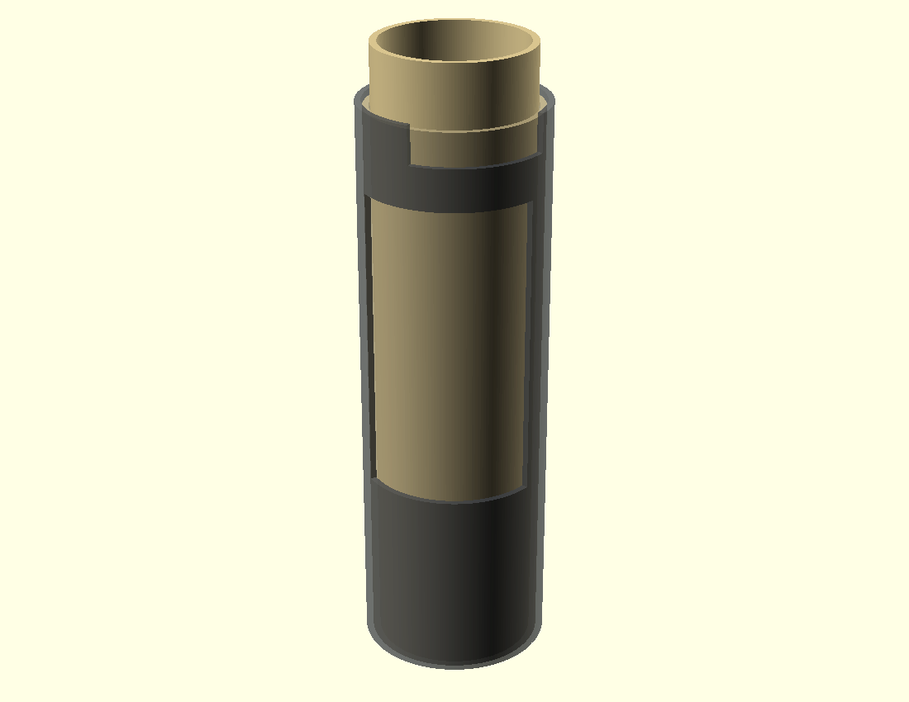
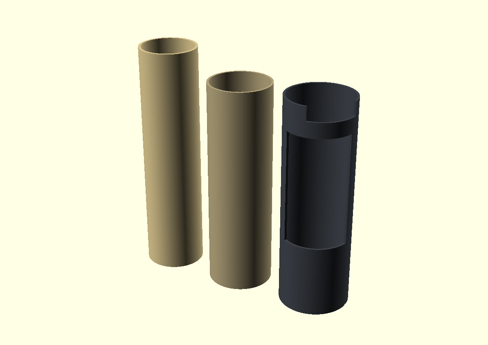

# 3D-Printable Bygrave Position Line Calculator

A 3D-printable mechanical core for building a working **Bygrave Position Line Calculator** for celestial navigation.

The Bygrave is a cylindrical slide rule designed to solve the spherical triangle used in celestial sight reduction. This project provides printable concentric tubes and an outer cursor/frame intended to be used with the excellent reproduction scale artwork created by **Wayne Harrison**.

## Project status

This is an early prototype intended for practical experimentation, dimensional calibration, and eventual use with Harrison's scale artwork.

The current design includes:

- parametric OpenSCAD source
- inner scale tube
- middle scale tube
- outer cursor/frame tube
- calibration rings
- assembled and exploded reference renders

The mechanical design is deliberately simple so that diameters, clearances, and tube lengths can be adjusted after real-world test prints.

## Files

| File | Purpose |
|---|---|
| `bygrave_3dprint.scad` | Parametric OpenSCAD source |
| `bygrave_inner_tube.stl` | Inner/cotangent-scale tube |
| `bygrave_middle_tube.stl` | Intermediate/cosine-scale tube |
| `bygrave_outer_cursor_tube.stl` | Outer cursor/frame tube |
| `bygrave_calibration_rings.stl` | Short test rings — print these first |
| `bygrave_assembly.png` | Assembled render |
| `bygrave_exploded.png` | Exploded render |

## Scale artwork

The scale artwork used as the dimensional basis for this project was created by **Wayne Harrison** as part of his Bygrave reproduction work.

His project page is here:

- [Wayne Harrison — Bygrave Position Line Calculator](https://sites.google.com/site/nwayneharrison/home-1/home/bygrave-position-line-calculator)

The three scale PDFs are currently hosted by Harrison on Google Drive:

- [BygraveOuterv1.PDF](https://drive.google.com/uc?id=1IrVQKK_weB279gs3gEThEIHK9tWyrfMt&export=download)
- [BygraveInnerv1.pdf](https://drive.google.com/uc?id=1CY2NsDVFTGT7_ikUx5sv4jWs2JfmGCPY&export=download)
- [ByGraveMiddleV1.pdf](https://drive.google.com/uc?id=1YdEeBbvnmQ9Cu7vAnQecdasszpAixOGi&export=download)

**These PDFs are not included in this repository.** Harrison's artwork is copyrighted, and permission to redistribute it is being requested. Until explicit permission is granted, this repository links to the original files rather than mirroring them.

## Dimensions used

Measurements taken from the registration/template geometry of Harrison's PDFs correspond closely to the historical Bygrave diameters:

| Part | Target circumference | Approx. diameter |
|---|---:|---:|
| Inner scale | 169.6466 mm | 54.0002 mm |
| Middle scale | 185.3438 mm | 58.9968 mm |
| Outer template | 200.9140 mm | 63.9529 mm |

Default tube lengths are:

- inner: **215.90 mm**
- middle: **194.90 mm**
- outer: **196.85 mm**

The outer cursor windows were positioned from the cutout geometry in Harrison's outer scale sheet.

## Print the calibration rings first

Before printing the full-length tubes:

1. Print `bygrave_calibration_rings.stl` using the same material, nozzle, slicer settings, wall count, and orientation you plan to use for the final parts.
2. Measure the actual outside diameters with calipers in several directions.
3. Measure the thickness of the paper or adhesive film you intend to use for the scales.
4. Adjust the CAD diameter or PDF print scaling if needed.

For a first-order estimate, if the paper thickness is (t) and the measured plastic diameter is (D), the effective diameter at the approximate center of the paper thickness is

[
D_{eff} \approx D + t
]

and therefore

[
C_{eff} \approx \pi(D+t)
]

Even thin paper matters when the goal is navigation-grade scale accuracy.

## Printing notes

- **PLA** is fine for initial prototypes.
- **PETG** may be preferable for a tougher finished instrument.
- Print vertically if your printer can reliably handle a tube about 216 mm tall.
- Use at least 3–4 perimeters.
- A layer height around 0.16–0.20 mm should be adequate.
- Dimensional calibration matters more than cosmetic layer height.
- Do not sand the scale-bearing outside diameter until after measuring it.

The default bores are intentionally somewhat generous:

- middle ID: **54.80 mm**
- outer ID: **59.80 mm**

The tubes should rotate and slide freely without binding.

## Scale printing

Use thin, smooth, dimensionally stable paper or adhesive film. Heavy glossy photo paper is less desirable because it changes the effective scale radius and resists wrapping.

When printing the scale PDFs:

- disable **Fit to page**
- print at a controlled scale
- verify the registration width with a ruler or calipers before gluing
- prefer uniform scaling, since the spiral pitch is part of the scale geometry

For the outer tube, align the left edge of the printed template with the small seam witness notch in the STL.

## Background

Wayne Harrison's reproduction work was based on an original Bygrave owned by Francis Upchurch. Harrison recreated the scale artwork and built a working facsimile; Upchurch reportedly used a reproduction while sailing and checked it against GPS.

For background on the instrument, Harrison also recommends Ronald W. M. van Riet's paper:

- [Position Line Slide Rules (PDF)](https://www.rechenschieber.org/PositionLineSlideRules.pdf)

## Attribution and copyright

The 3D mechanical files in this repository are a modern reconstruction project.

Wayne Harrison's scale artwork is separate copyrighted work and is **not redistributed here** at present. Links above point to Harrison's original hosted files.

If permission is granted to redistribute the scale PDFs, this repository can later be updated so that the complete printable project is preserved in one place.

## Disclaimer

This is an experimental reproduction of a historical navigation instrument. Verify dimensions, scale calibration, and calculated results independently before relying on it for real navigation.
