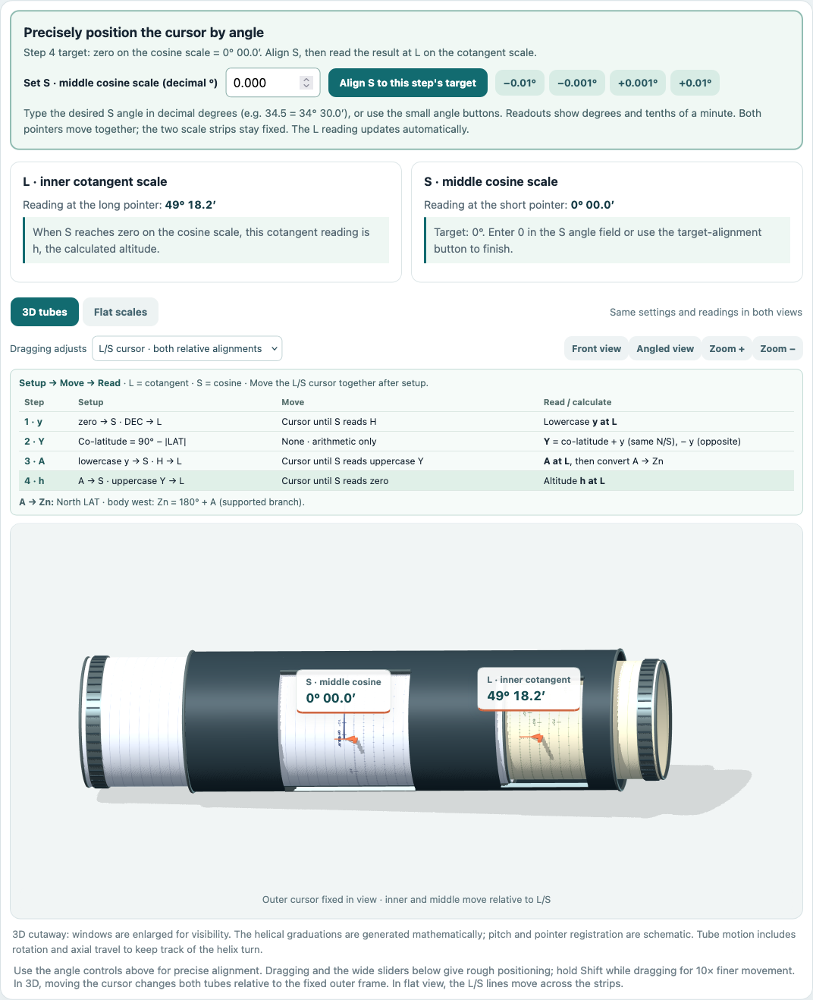
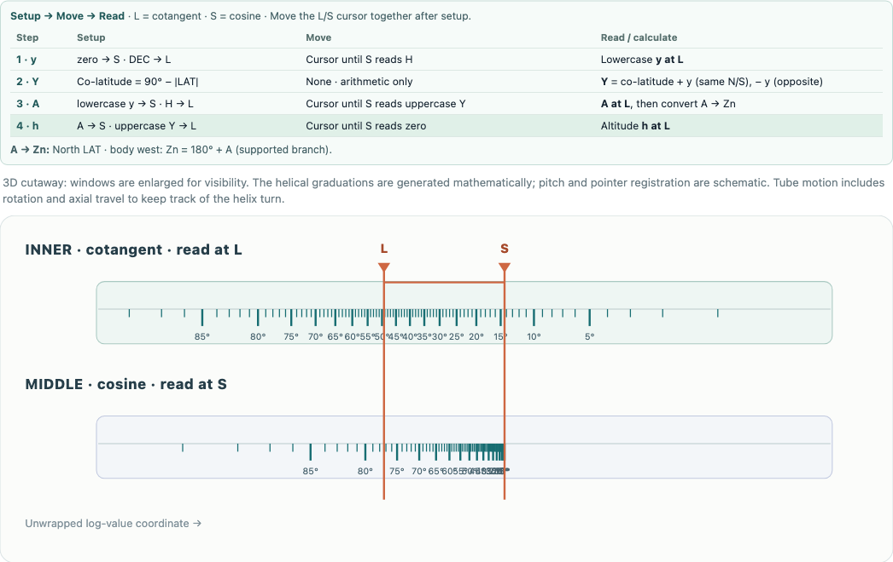

# Bygrave browser simulator

An interactive teaching simulator for Bygrave celestial sight reduction, with 3D tubes and flat scales. This folder is independent of the repository's OpenSCAD, STL, and printer reference images. The simulator generates mathematical graduations and does not include Harrison's scale artwork.

## Screenshots

The completed example reduction in 3D, with the compact symbolic flow directly above the full-width tube:



The same settings in flat view:



## Install and launch

Requirements: **Python 3** and a modern browser. The 3D view needs WebGL; a flat view is available if WebGL cannot start. Three.js is bundled locally, so no npm installation, API key, or CDN connection is needed to run the page.

### Get the project

From a terminal:

```sh
git clone https://github.com/kq6up/bygrave.git
cd bygrave
```

Alternatively, choose **Code → Download ZIP** on GitHub, extract the ZIP, and open a terminal in the extracted repository folder. Install Python 3 first if it is not already available.

### Serve the files

From the **repository root**, run:

```sh
python3 -m http.server 8000 --bind 127.0.0.1
```

On Windows, the equivalent launcher is usually:

```powershell
py -3 -m http.server 8000 --bind 127.0.0.1
```

Open **[http://127.0.0.1:8000/simulator/](http://127.0.0.1:8000/simulator/)**. Leave the terminal running; press **Ctrl+C** to stop it. The server binds to your own computer.

If port 8000 is busy, replace it with 8001 in both the command and URL. Open the page through this server rather than double-clicking `index.html`: JavaScript modules need HTTP. If you start the server from inside this `simulator/` folder instead, use `http://127.0.0.1:8000/`.

After editing or updating the files, reload the browser page. If it still shows an older version, use the browser's reload-without-cache command.

## Enter a sight

The **Sight inputs & independent check** fields accept **decimal degrees**:

- **LAT:** north positive, south negative.
- **DEC:** north positive, south negative.
- **Hour angle:** west positive, east negative. H is its absolute magnitude. This field uses a signed hour angle rather than the almanac's full 0°–360° LHA convention.

Convert degrees and minutes to an input using `degrees + minutes / 60`, applying the sign to the whole angle. Displayed angle readings use **degrees, minutes, and tenths of a minute**, such as `34° 20.5′`. Calculations retain their precision; the readout rounding is for display.

The supplied example is editable. Changing any sight input clears the previous reduction; click **Set up step 1** to begin again. The independent check is calculated separately from the scale readings.

## Setup → Move → Read

**S reads the middle cosine scale; L reads the inner cotangent scale.** The setup buttons position the scales. During each subsequent motion, adjust the L/S cursor together while preserving the relative settings of the two scales.

| Step | Setup, S first / L second | Move | Read or calculate |
|---|---|---|---|
| 1 | Zero at S; DEC at L | Cursor until S reads H | Lowercase y at L |
| 2 | Use y and co-latitude = 90° − \|LAT\| | No instrument movement | Y = co-latitude + y for same-name LAT/DEC; − y for opposite names |
| 3 | Lowercase y at S; H at L | Cursor until S reads uppercase Y | A at L; convert A to Zn |
| 4 | A at S; uppercase Y at L | Cursor until S reads zero | Calculated altitude h at L |

The detailed cards above the instrument provide the progression buttons and explanations. The compact symbolic table immediately above the full-width tube repeats the logic and highlights the current step.

### A → Zn

Zn is the true bearing clockwise from north. For the supported ordinary branch:

| Latitude | Body's direction | Conversion |
|---|---|---|
| North | West | Zn = 180° + A |
| North | East | Zn = 180° − A |
| South | West | Zn = 360° − A |
| South | East | Zn = A |

These rules are also on the page, with the rule for the current sight repeated above the tube. Other branches require additional quadrant rules.

## Controls and displays

- Drag the selected part of the 3D display, or the corresponding part in flat view. Hold **Shift** for tenfold finer dragging.
- Use the wide sliders for rough positioning; precise numeric offsets and small nudge buttons adjust each part separately.
- Enter a desired **S angle in decimal degrees**, use the angular nudges, or click **Align S to this step's target** for exact target positioning.
- The scale controls are ordered **cosine/S first, cotangent/L second**, matching the tube. The cursor control moves both pointer relationships together.
- Switch between **3D tubes** and **Flat scales** without losing the settings or reduction. Front/angled view and zoom change the camera only.

The outer shell remains fixed in the 3D camera view; cursor movement is shown as relative movement of both scale tubes. The scene's coupled rotation and axial travel are illustrative, not a verified reproduction of an internal screw mechanism.

## Supported sights and limits

This version implements the **ordinary first-quadrant branch**, not every possible Bygrave sight:

- LAT and DEC must be nonzero and have magnitudes below 90°.
- The signed hour-angle magnitude must be greater than 0° and below 90°; the final **20 arcminutes near 90°** are excluded, so the usable magnitude is below 89°40′.
- Calculated uppercase Y must be strictly between 0° and 90°.
- Supplementary-angle branches and special near-singular procedures are not implemented. An A near 90° triggers a caution about special handling.
- The scene's helix pitch, turn count, window layout, and pointer registration are schematic. Extreme settings can extend beyond the illustrated tube lengths, and finite cursor travel can limit alignment.

The simulator does not establish the printed instrument's fit, physical calibration, or navigation accuracy. See [geometry notes](docs/geometry-notes.md) and [recorded development checks](docs/validation-results.md).

## Source layout and developer checks

- `index.html`, `style.css`: interface and instructions.
- `src/app.js`: controls, readings, and guided reduction.
- `src/math.js`: scale transforms and independent spherical-trig reference.
- `src/angles.js`: degrees/minutes display formatting.
- `src/coordinates.js`: shared flat/helical coordinates.
- `src/view3d.js`: 3D rendering and interaction.
- `vendor/three/`: bundled Three.js 0.186.1 and its [MIT license](vendor/three/LICENSE).
- `tests/`: existing mathematical and coordinate checks.

Node.js is needed only to run the optional developer checks. From this folder:

```sh
npm test
```

No `npm install` is needed. These checks cover the mathematical and coordinate functions; they do not certify the physical instrument or every browser interaction.
